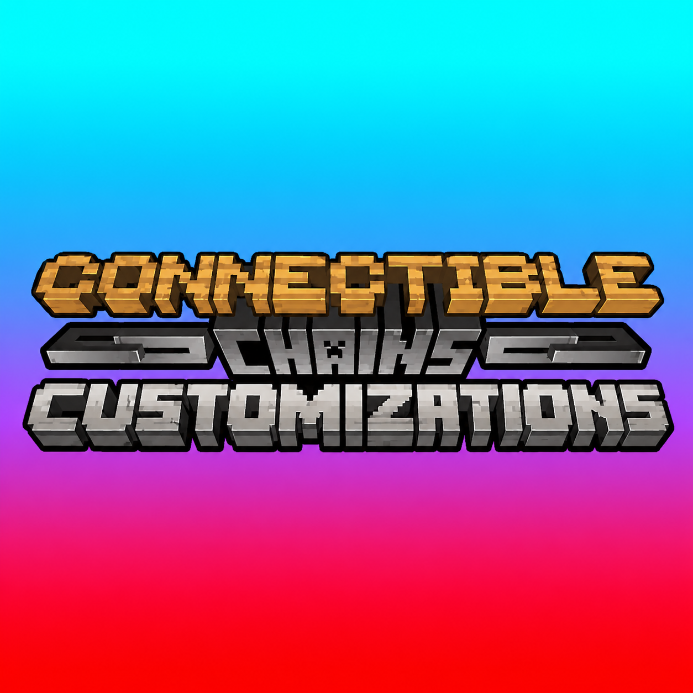

# Connectible Chains: Customizations 2.0

An addon for **Reconnectible Chains** (Minecraft 26.3, Fabric Loader 0.20.1). It picks which items can hang on chains, whether each one is drawn as its block or its item texture, and its scale, offset and rotations. Everything is set from an in-game menu.

## Dependencies

Install all of these on **both the server and every client**:

| Dependency | Version | Required |
|---|---|---|
| Minecraft | 26.3 | Yes |
| Fabric Loader | 0.20.1 or newer | Yes |
| Java | 25 or newer | Yes |
| Fabric API | Any 26.3 version | Yes |
| YACL (Yet Another Config Lib) | 3.9.0 or newer | Yes |
| Reconnectible Chains | 2.4.3 or newer (tested with 2.5.0 and 2.6.0) | Yes |

There are no optional dependencies.

## Building

1. Install a **Java 25** JDK. If you skip this, Gradle tries to download it.
2. Copy the Reconnectible Chains Fabric 26.3 `.jar` from your `mods` folder into `libs/`. It's only used to compile against.
3. In this folder, run `gradlew.bat build` (Windows) or `./gradlew build`.
4. The mod is `build/libs/connectible-chains-customizations-2.0.0.jar`. Ignore any `-sources.jar` file.

## Installing

2.0 runs on **both the server and every client**. The server keeps the settings and decides what can hang. Clients draw the items and show the menu.

- **Server:** add `connectible-chains-customizations-2.0.0.jar`. It needs Fabric API, YACL and Reconnectible Chains, which the server already has because Reconnectible Chains requires them. **Remove the old `hangable_items` datapack.** Anything in that tag can still be hung even after you take it out of the menu.
- **Every client pack:** replace the 1.0.x jar with `connectible-chains-customizations-2.0.0.jar`. A player without it can still join. They just won't see items that have no block form, and they can't open the menu.
- The old `config/chainitemhangings.json` isn't used any more and can be deleted.

## The menu

Bind **Open Chain Customizations menu** in Options → Controls → Key Binds. It's unbound by default so it doesn't clash with your other keys.

- **On a server:** only operators (permission level 2+) can open it. Everyone else gets a chat message saying so, and the server also rejects edits from non-operators.
- **In singleplayer:** you can always open it, unless the world is opened to LAN. Then the usual operator rule applies.

Saving sends the settings to the server, which saves them and updates everyone straight away.

It has four sections:

1. **General:** the default scale for item textures (0.75) and for blocks (1.0), and the gap below the chain.
2. **Items Displayed as Their Block:** these hang drawn as their block model.
3. **Items Displayed as Their Item Texture:** these hang drawn as their item, with 3D models used when an item has one.
4. **Per-item Settings:** one collapsible group per list entry, with Scale, Offset, Rotation and XZ Rotation. After you add an entry to a list, save, close and reopen the menu to see its group.

### Entries and groups

Each list entry, and each Per-item Settings group, can be:

| Entry | Example | Matches |
|---|---|---|
| An item ID | `minecraft:stick` | That one item |
| A `*` wildcard | `*_door`, `*_trapdoor`, `mymod:*_wall` | Every item whose ID matches, from any mod, whether or not that mod tags its items. A wildcard without a `modid:` part matches every mod |
| A `#tag` | `#minecraft:doors` | Only the items mods have added to that tag |

For big groups of retextured things (walls, fences, fence gates, doors, trapdoors and so on), use wildcards. They catch modded variants without any extra work. The defaults do this: `*_fence`, `*_wall`, `*lightning_rod`, `*_shovel` and `*_spear`.

The most specific entry wins: **an item ID beats a wildcard, and a wildcard beats a tag.** So you can put `*_door` in one list and `minecraft:iron_door` on its own, either with its own settings or in the other list.

List entries have a search box: start typing and it suggests matching wildcards, item tags and item IDs, narrowing as you type.

### Per-item settings

- **Scale:** 0 uses the default from General.
- **Offset:** extra drop below the chain, in blocks. Negative raises the item, and a large enough negative value lifts it above the chain.
- **Rotation:** turns the item in its own flat plane. Flip the sign to turn the other way.
- **XZ Rotation:** spins the item like it's on a pole running top to bottom through its center. It doesn't change how high the item hangs.

With Offset at 0, nothing is drawn above the chain. When an item or block is turned, it's lowered so its highest corner sits right at the chain. A tool turned 135° hangs with its handle tip touching the chain.

### The config file

The settings live on the server in `config/chain_customizations.json`, under the same four section names. You can edit it by hand while the server is stopped. The menu is easier.

## If something goes wrong

- **`cannot find symbol HangingBlockRenderer` / `ChainRaycastHelper`:** the Reconnectible Chains jar isn't in `libs/`.
- **The Loom plugin can't be found:** change `1.16-SNAPSHOT` in `build.gradle.kts` to the newest 1.16 version listed at https://maven.fabricmc.net/net/fabricmc/fabric-loom/
- **Any other compile error, or a crash with `Mixin apply failed`:** send the error text or `logs/latest.log`.

## Credits

- **Connectible Chains** by legoatoom, and its fork **Reconnectible Chains** by evanbones. This addon builds on their mod and would be nothing without it.
- The icon is based on the Connectible Chains logo.

## Contact

Business inquiries: [the.real.cogamer103@gmail.com](mailto:the.real.cogamer103@gmail.com)
